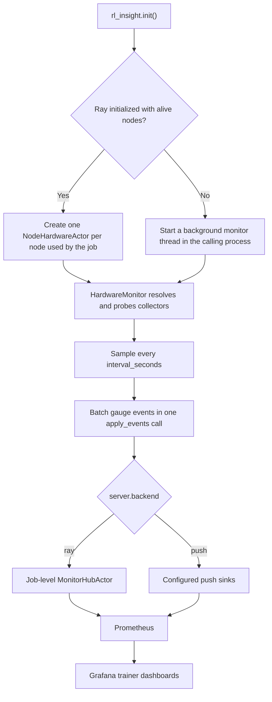

# Hardware Monitoring

RL-Insight collects hardware metrics through a background monitor started by `rl_insight.init()`. The monitor samples the node periodically and reports through the standard RL-Insight metric pipeline, so no external exporter process or port is required. Under Ray, one monitor runs per node used by the job; otherwise the monitor runs as a background thread in the calling process.

## 1. Prerequisites

The system collectors (CPU, memory, network and disk) use psutil, which is a built-in dependency of RL-Insight. Vendor accelerators are optional:

| Accelerator | Requirement                        | Note                                                               |
| ----------- | ---------------------------------- | ------------------------------------------------------------------ |
| NVIDIA GPU  | `pip install rl-insight[nvidia]` | Optional extra; installs `nvidia-ml-py`                          |
| Ascend NPU  | `npu-smi` on `PATH`            | Included with the Ascend driver; Atlas A2, A3 and A5 are supported |

Missing tooling does not interrupt training. The affected collector is reported as unavailable through a status metric, and the remaining collectors continue to work.

## 2. Enable hardware monitoring

Hardware monitoring is disabled by default. It is enabled and configured through the `hardware` section of `rl_insight.init()`:

```python
import rl_insight

rl_insight.init(
    project="verl",
    experiment_name="ppo-run",
    config={
        "server": {"url": "http://<SERVER_IP>:18080"},
        "hardware": {
            "enabled": True,                # default is False; set True to enable
            "interval_seconds": 10,         # sampling interval, minimum 5
            "collectors": [                 # collectors to run
                "cpu", "gpu", "npu", "ray_actor_process",
            ],
        },
    },
)
```

Notes:

- In a Ray job, `init()` creates one hardware actor on the driver node and on every node that hosts an alive actor of the current job. The node set is reconciled while the job runs, so nodes added after `init()` are monitored and nodes no longer used by the job are released. Nodes used only by other jobs are not monitored. Node actors are created as detached actors, so they are not destroyed when the worker that created them exits or calls `finish`; each actor exits by itself when its job ends. Outside Ray the monitor runs as a thread in the calling process. Both modes select their transport from `server.backend`: `ray` forwards samples to the job-level hub, and `push` writes them directly to the configured sinks.
- The `cpu` collector covers CPU, memory, network and disk metrics. The `gpu` and `npu` collectors cover NVIDIA and Ascend accelerators respectively; missing vendor tooling disables only the affected collector.
- The `self_process` collector is enabled by default. It reports the CPU and memory usage of the process hosting the monitor: the node-scoped hardware actor under Ray, or the process that called `init()` outside Ray. Use `ray_actor_process` for the per-worker view, and remove `self_process` from `collectors` when the self-monitoring panel is not needed.
- The `ray_actor_process` collector is enabled by default. It reports the CPU, thread and memory usage of every Ray actor of the current Ray job on the node under the `rlinsight_ray_process_*` families, with `pid` and an inferred `worker_role` label. The Ray State API `list_actors` call is cluster-wide, so the query is filtered by the current `job_id`; workers of other jobs sharing the node are not attributed to this job and cannot pollute the `worker_role` or `device_index` dropdowns. The role is derived from the actor class name: `ActorRolloutRefWorker`, `CriticWorker` and `FusedWorker_<roles>` map to the corresponding roles, while verl's default colocated workers share one anonymous `WorkerDict` class, which carries no role and is reported as `worker`; those processes are distinguished by `pid`. The collector requires the Ray State API and reports itself unavailable outside a Ray job, so it is safe to keep in the default list.
- `ray_actor_process` also adds two labels that link process panels to device panels: `local_rank`, taken from the actor name suffix `<Class>_<pg_idx>:<local_rank>` (the device ordinal inside the node), and `device_index`, read from `ASCEND_RT_VISIBLE_DEVICES` or `CUDA_VISIBLE_DEVICES` in the process environment and using the same card numbering as the NPU and GPU panels, so one dropdown can filter cards and processes together. When the value is a multi-card list, missing or unparsable, the label is reported as an empty string rather than omitted. A metric family must keep a fixed label dimension; otherwise the hub's Prometheus registry raises `DuplicateTimeseries` and drops batches as soon as workers with different label sets appear. RL-Insight's own node-scoped actors (`MonitorHubActor`, `NodeHardwareActor`) are skipped so that the monitor's own footprint is not counted as a training worker.
- `worker_role` is a **process-level** label. It describes the process that reported the sample, not the node. The process-level families (`rlinsight_ray_process_*` and `rlinsight_process_*`) always carry the key and use an empty value when the role is unknown. `ray_actor_process` infers the label from the Ray actor class name; `self_process` describes the monitor's own process and reports an empty value.
- `interval_seconds` defaults to 10 seconds, a conservative value that keeps collection overhead low while still producing a usable time series. Values below 5 are clamped to 5 with a `RuntimeWarning`. Each round runs the psutil collectors and one device query per card. On NPU hosts, `npu-smi info` is invoked once per round with a 5-second timeout. Increase the interval on large clusters and decrease it only when finer resolution is required.
- The `RL_INSIGHT_HARDWARE_ENABLED` environment variable overrides `hardware.enabled` (`1/0`, `true/false`, `yes/no`, `on/off`, case-insensitive). It is read only in the process that calls `init()`, and the resolved value is passed to the node actors as a constructor parameter. The actors never re-read the variable.
  - **Outside Ray**: each process reads its own environment, so per-process enable and disable settings are effective.
  - **Under Ray**: the configuration is job-wide. The first process that calls `init()` and creates the node actors determines `enabled`, `interval_seconds` and `collectors`. Later `init()` calls from other workers reuse the existing actors, and their environment variables do not reconfigure them. To disable hardware monitoring for the whole job, set the variable in the first `init()` process, usually the driver, or at job-level `runtime_env.env_vars`. There is no need to set it on every training node; setting `RL_INSIGHT_HARDWARE_ENABLED=0` on only some training workers does not stop node actors that already exist.
  - Only the RL-Insight server URL is forwarded automatically through the hub actor's `runtime_env`. All other settings travel through the merged config and actor constructor parameters.

## 3. Metrics

All metrics are Prometheus gauges named with the `rlinsight_` prefix and exposed with the RL-Insight metric namespace, for example `rl_insight_monitor_rlinsight_cpu_utilization_percent`. Rates are computed from monotonic counters and reported per second. NPU metric names follow the NPU Exporter naming convention; GPU and host metrics follow the corresponding exporter semantics.

| Family            | Metrics                                                                                                                                                                                                                                                                                       |
| ----------------- | --------------------------------------------------------------------------------------------------------------------------------------------------------------------------------------------------------------------------------------------------------------------------------------------- |
| CPU               | `rlinsight_cpu_utilization_percent`, `rlinsight_cpu_logical_count`, `rlinsight_cpu_physical_count`, `rlinsight_cpu_cgroup_throttled_periods`, `rlinsight_cpu_cgroup_throttled_seconds`                                                                                              |
| Memory            | `rlinsight_memory_used_bytes`, `rlinsight_memory_available_bytes`, `rlinsight_memory_utilization_percent`, `rlinsight_memory_cgroup_limit_bytes`, `rlinsight_memory_cgroup_usage_bytes`                                                                                             |
| Network           | `rlinsight_network_receive_bytes_per_second`, `rlinsight_network_transmit_bytes_per_second`                                                                                                                                                                                               |
| Disk              | `rlinsight_disk_read_bytes_per_second`, `rlinsight_disk_write_bytes_per_second`, `rlinsight_disk_utilization_percent`                                                                                                                                                                   |
| Ray actor process | `rlinsight_ray_process_cpu_percent`, `rlinsight_ray_process_thread_count`, `rlinsight_ray_process_rss_bytes`                                                                                                                                                                            |
| Self process      | `rlinsight_process_cpu_percent`, `rlinsight_process_thread_count`, `rlinsight_process_rss_bytes`, `rlinsight_process_rss_percent`                                                                                                                                                     |
| NVIDIA GPU        | `rlinsight_gpu_utilization_percent`, `rlinsight_gpu_memory_used_bytes`, `rlinsight_gpu_memory_total_bytes`, `rlinsight_gpu_memory_utilization_percent`, `rlinsight_gpu_temperature_celsius`, `rlinsight_gpu_power_watts`, `rlinsight_gpu_info`                                  |
| Ascend NPU        | `rlinsight_npu_chip_info_utilization`, `rlinsight_npu_chip_info_hbm_used_memory`, `rlinsight_npu_chip_info_hbm_total_memory`, `rlinsight_npu_chip_info_hbm_utilization`, `rlinsight_npu_chip_info_hbm_bandwidth_utilization`, `rlinsight_npu_chip_info_temperature`, `rlinsight_npu_chip_info_power`, `rlinsight_npu_chip_info_health_status`, `rlinsight_npu_chip_info_name` |
| Diagnostics       | `rlinsight_hardware_collector_available`                                                                                                                                                                                                                                                    |

NPU memory metrics are reported in megabytes, matching NPU Exporter. Stable labels are `project`, `experiment_name`, `run_id` and `node`; device metrics additionally carry `device_vendor` and `device_index`. The two process families have different label contracts:

- `rlinsight_ray_process_*` (`ray_actor_process`, enabled by default) always carries `pid`, `worker_role`, `local_rank` and `device_index`. `worker_role` is inferred from the Ray actor class name, `local_rank` comes from the `<pg_idx>:<local_rank>` suffix of the actor name, and `device_index` comes from `ASCEND_RT_VISIBLE_DEVICES` or `CUDA_VISIBLE_DEVICES` in that process environment. Unknown values are reported as empty strings.
- `rlinsight_process_*` (`self_process`, enabled by default) always carries `pid` and `worker_role`, and does **not** have `local_rank` or `device_index`. It describes the process hosting the monitor, which is the `NodeHardwareActor` under Ray or the process that called `init()` outside Ray. It therefore has no worker-level local rank, and its environment does not represent a training worker's device binding. Filtering this family by `device_index` or `local_rank` returns no data. `worker_role` is reported as an empty string.

Every other family is node-level. On device metrics, `device_index` is the physical card number: `npu-smi` numbering for NPU and NVML indexing for GPU. On `ray_actor_process`, it is the same physical card number assigned to that process, so both kinds of series can be filtered by one shared `device_index` value. Device metrics are emitted per logical device or chip. NPU series are scoped to `ASCEND_RT_VISIBLE_DEVICES` and GPU series to `CUDA_VISIBLE_DEVICES` when it lists plain integer indexes, so a job pinned to a subset only reports the cards it uses. Non-integer forms such as PCI bus IDs, GPU UUIDs and MIG IDs cannot be mapped onto NVML indexes and leave every GPU of the node visible. The `*_info` metrics are constant `1` gauges that carry the device name and driver version as labels. `rlinsight_disk_utilization_percent` carries the measured path as a `path` label; the disk collector always measures the root filesystem (`/`). Cgroup metrics appear only when the runtime exposes container limits; the two `rlinsight_cpu_cgroup_throttled_*` metrics are cumulative since the container started, so derive rates with `rate()` in PromQL.

## 4. Reporting flow



Collectors are resolved from the configured `hardware.collectors` list and probed once at startup. A collector that cannot initialize is reported as unavailable through `rlinsight_hardware_collector_available` and is not sampled. Collector or transport failures are downgraded to diagnostics and never interrupt the training process.

## 5. View in Grafana

Hardware metrics appear in the hardware metric row of the trainer dashboards, such as `verl_trainer_v1_with_vllm_engine`. No separate dashboard or exporter deployment is required.

Each hardware panel contains two queries per series: the built-in query (visible by default) and the legacy exporter query (hidden by default). The RL-Insight server selects the source per metric family when it stages the dashboards. CPU, memory, network and disk panels switch to the exporter query only when a `node-exporter` target is registered; NPU panels switch only for `npu-exporter`, and GPU panels only for `dcgm`. Target matching is a case-insensitive job-name prefix through `rl-insight add-targets`. Families whose exporter is not registered keep the built-in query, so registering only some exporters does not turn the other panels into `No data`. The panels never mix sources with PromQL `or` and never draw duplicate lines when both sources are scraped. Device series use the exporter-style legends `NPU {{id}}` and `GPU {{id}}`, with `device_index` rewritten into the `id` label.

The host panels (CPU, memory, network and disk) are titled with a `Node` prefix. Their values cover every process on the node rather than only this training job, so they should not be read as per-job resource usage on a shared node.

The `Ray Actor Process CPU` and `Ray Actor Process Memory` panels are process-level, with the legend `{{node}} {{device_index}} {{worker_role}} {{pid}}`. They cover every Ray worker on the node through the `ray_actor_process` collector, which is enabled by default. The `Self Process CPU` and `Self Process Memory` panels cover the process that runs the monitor, with the legend `{{node}} {{worker_role}} {{pid}}`, and only draw data once `self_process` is enabled. The `hardware: Worker Role` variable filters by role, and the `hardware: Device` variable filters by `device_index` using the same condition as the NPU and GPU panels. Selecting a card narrows the process panels and the device panels together; CPU-pool processes without a card label drop out, and selecting `All` restores the full set.

Multi-node layouts behave the same in both modes. The machine dimension is unified on the `node` label: it is native on built-in series and synthesized from the `instance` address for exporter and DCGM series inside the panel queries. An IPv6 target's `instance` looks like `[2001:db8::1]:8082`; the synthesis strips the brackets so that the value matches the unbracketed address carried by the built-in label, and the panel's `instance` filter also accepts the bracketed form. Legends (`{{node}} NPU {{id}}`) render identically in both modes, and multi-node series never collide. Node switching uses the `hardware: Node` picker at the top, which reads the `node` label and falls back to the host part of the exporter `instance` when the deployment lacks the built-in identity metric. `All` aggregates every node, and a multi-selection keeps only the chosen nodes.

The `CPU / Host Metrics` and `Ascend NPU Metrics` rows are not repeated into per-node tabs. Row repetition requires the node variable to resolve while the dashboard loads, but this variable comes from an instant query evaluated at the end of the time range. A finished run therefore resolves it to nothing, and the whole row would collapse into one empty tab that renders no panels. A 1024-card cluster would also create hundreds of tabs. Both rows render flat (never repeated per node), and the node filter lives in the panel queries (`node=~"$node"`, degrading to match-all when the variable is empty). On a single-node run the variable has one value, so behavior is unchanged. Only the two `Ray Actor Process` legends sort by `Max` descending; every other hardware panel keeps its natural series order, so the NPU and GPU panels stay in rank order (`NPU 0`, `NPU 1`, and so on).

The `Ascend NPU Metrics` and `NVIDIA GPU Metrics` rows render only when the current time range contains metrics for that vendor. An NPU-only host therefore hides the empty NVIDIA GPU row, and the reverse also applies. When neither vendor has data (for example a time range without training data), neither row renders.

## 6. Troubleshooting

A collector reports `0` in `rlinsight_hardware_collector_available`:

- `gpu` = 0: `nvidia-ml-py` is not installed (`pip install rl-insight[nvidia]`), or no NVIDIA driver or devices are visible.
- `npu` = 0: `npu-smi` is not on `PATH`. Inside training containers, the Ascend driver usually needs to be present; mount the host binary if it is missing:

```bash
docker run ... -v /usr/local/sbin/npu-smi:/usr/local/sbin/npu-smi ...
```

- A collector reports `1` but its panels are empty: `rlinsight_hardware_collector_available` reports whether the collector initialized its tooling, not whether the node has devices. An installed `npu-smi` that reports no cards, or whose query fails on a given round, still shows `npu` = 1 with empty panels. The same applies to `gpu`. A runtime query failure logs one `npu-smi info failed` warning on the node; further failures are logged at debug level.
- Host-level series appear duplicated or missing on multi-node Ray clusters: verify that all nodes can reach the RL-Insight server, that the Ray State API is available (nodes are discovered from the current job's alive actors), and that no `hardware actor ... is still pending` warning is logged.
- Batches dropped because the transport failed are logged with `failed to forward ... hardware events; dropping them` on the reporter side. There is no dropped-events metric, because the transport that would carry it is the one that failed. Check the RL-Insight server status when these warnings appear.

## Legacy exporter-based monitoring

Exporter-based hardware monitoring (node_exporter, NPU Exporter and DCGM) is deprecated. The built-in monitor described above provides the same hardware panels without a separate exporter deployment. The legacy guides remain available for existing Prometheus deployments:

- [CPU, memory and network exporters (deprecated)](cpu_monitoring_en.md)
- [NPU Exporter (deprecated)](npu_monitoring_en.md)
