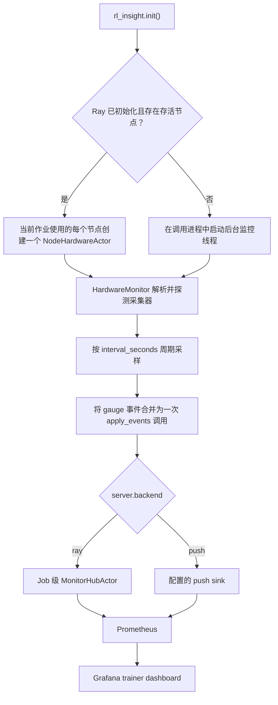

# 硬件监控

RL-Insight 通过 `rl_insight.init()` 启动的后台监控器采集硬件指标。监控器周期性采样节点硬件，并通过 RL-Insight 标准指标链路上报，因此无需部署独立的 exporter 进程或暴露额外端口。Ray 作业中每个作业使用的节点运行一个监控器；非 Ray 环境下，监控器以后台线程方式运行在调用进程中。

## 1. 前置条件

系统采集器（CPU、内存、网络、磁盘）依赖 psutil，该库是 RL-Insight 的内置依赖。厂商加速器为可选项：

| 加速器     | 要求                               | 说明                             |
| ---------- | ---------------------------------- | -------------------------------- |
| NVIDIA GPU | `pip install rl-insight[nvidia]` | 可选依赖组，安装 `nvidia-ml-py` |
| 昇腾 NPU   | `npu-smi` 位于 `PATH`          | 随昇腾驱动提供，支持 Atlas A2、A3、A5 |

缺少厂商工具不会中断训练。对应采集器会通过状态指标上报为不可用，其余采集器继续正常工作。

## 2. 开启硬件监控

硬件监控默认关闭，需通过 `rl_insight.init()` 的 `hardware` 配置段显式开启：

```python
import rl_insight

rl_insight.init(
    project="verl",
    experiment_name="ppo-run",
    config={
        "server": {"url": "http://<SERVER_IP>:18080"},
        "hardware": {
            "enabled": True,                # 默认值 False；设为 True 开启
            "interval_seconds": 10,         # 采样间隔，最小 5 秒
            "collectors": [                 # 启用的采集器
                "cpu", "gpu", "npu", "ray_actor_process",
            ],
        },
    },
)
```

说明：

- Ray 作业中，`init()` 会在 driver 节点以及承载当前作业存活 actor 的每个节点上创建一个硬件 actor。作业运行期间会持续校正节点集合：`init()` 之后新增的节点会被纳入监控，不再被作业使用的节点会被释放；仅被其他作业使用的节点不会被监控。节点级 actor 以 detached 方式创建，不会因创建它的 worker 进程退出或调用 `finish()` 而销毁，并在其所属作业结束后自行退出。非 Ray 环境下，监控器以线程方式运行在调用进程中。两种模式均按 `server.backend` 选择上报通道：`ray` 发往 job 级 Hub，`push` 直接写入配置的 sink。
- `cpu` 采集器覆盖 CPU、内存、网络和磁盘指标；`gpu` 与 `npu` 采集器分别覆盖 NVIDIA 和昇腾加速器。缺少厂商工具时仅禁用对应采集器。
- `self_process` 采集器默认启用。它上报运行监控的进程自身的 CPU 和内存占用：Ray 下为节点级硬件 actor，非 Ray 下为调用 `init()` 的进程。逐 worker 视图请使用 `ray_actor_process`；不需要该面板时，可从 `collectors` 中移除 `self_process`。
- `ray_actor_process` 采集器默认启用。它逐进程上报本节点上属于当前 Ray job 的每个 Ray actor 的 CPU、线程和内存占用，指标族为 `rlinsight_ray_process_*`，并附带 `pid` 与自动推断的 `worker_role`。Ray State API 的 `list_actors` 是集群级查询，此处按当前 `job_id` 过滤，因此多个作业共享同一节点时，不会把其他作业的 worker 计入本作业，也不会污染 `worker_role` 和 `device_index` 下拉选项。角色由 actor 类名推断：`ActorRolloutRefWorker`、`CriticWorker` 与 `FusedWorker_<roles>` 映射为对应角色；verl 默认的 colocated 模式下，所有训练 worker 共用一个匿名 `WorkerDict` 类，不含角色信息，统一上报为 `worker`，此时通过 `pid` 区分具体进程。该采集器依赖 Ray State API，非 Ray 作业下会报告为不可用，因此保留在默认列表中不会产生噪声。
- `ray_actor_process` 还会补充两个可与其他面板联动的标签：`local_rank` 取自 actor 名后缀 `<类名>_<pg_idx>:<local_rank>`，即该进程在本节点内的设备序号；`device_index` 从进程环境读取 `ASCEND_RT_VISIBLE_DEVICES` 或 `CUDA_VISIBLE_DEVICES`，与 NPU/GPU 面板使用同一卡号口径，因此可在同一个下拉中同时筛选卡与进程。标签值为多卡列表、无法获取或解析失败时，该标签上报为空字符串，而不是省略。同一指标族的标签维度必须固定，否则 hub 的 Prometheus 注册表在遇到标签集不同的 worker 时会抛出 `DuplicateTimeseries` 并丢弃整批样本。RL-Insight 自身的节点级 actor（`MonitorHubActor`、`NodeHardwareActor`）会被跳过，避免将监控自身开销计为训练 worker。
- `worker_role` 是**进程级**标签，描述上报样本的进程，而不是节点。进程级指标族（`rlinsight_ray_process_*` 与 `rlinsight_process_*`）始终携带该标签键，无法确定角色时其值为空字符串。`ray_actor_process` 由 Ray actor 类名自动推断该标签；`self_process` 描述监控自身进程，上报空字符串。
- `interval_seconds` 默认 10 秒，该取值较为保守，可兼顾采样开销与曲线可用性。低于 5 秒时会触发 `RuntimeWarning` 并钳制为 5 秒。每轮运行 psutil 采集器，并对每张卡发起一次设备查询。NPU 机器上每轮调用一次 `npu-smi info`，超时时间为 5 秒。大规模集群可适当增大间隔，仅在需要更细粒度时调小。
- `RL_INSIGHT_HARDWARE_ENABLED` 可覆盖 `hardware.enabled`（`1/0`、`true/false`、`yes/no`、`on/off`，大小写不敏感）。该变量只在调用 `init()` 的进程中读取，解析结果随后作为节点 actor 的构造参数下发，节点 actor 不会再次读取。
  - **非 Ray 模式**：每个进程读取自身环境，因此逐进程开关设置有效。
  - **Ray 模式**：配置为 job 级。第一个调用 `init()` 并创建节点 actor 的进程决定 `enabled`、`interval_seconds` 和 `collectors`。之后其他 worker 的 `init()` 只会复用已存在的 actor，其同名环境变量不会重新配置这些 actor。要关闭整个作业的硬件监控，应在首个调用 `init()` 的进程（通常是 driver）或 job 级 `runtime_env.env_vars` 中设置，无需在每个训练节点上分别设置；仅在部分训练 worker 上设置 `RL_INSIGHT_HARDWARE_ENABLED=0` 不会停止已创建的节点 actor。
  - 只有 RL-Insight server 地址会通过 hub actor 的 `runtime_env` 自动转发，其余配置通过合并后的 config 和 actor 构造参数传递。

## 3. 指标

所有指标均为 Prometheus gauge，使用 `rlinsight_` 前缀命名，并以 RL-Insight 指标命名空间暴露，例如 `rl_insight_monitor_rlinsight_cpu_utilization_percent`。速率类指标由单调计数器差分计算，按每秒上报。NPU 指标名遵循 NPU Exporter 命名规范；GPU 与主机指标遵循对应 exporter 的语义。

| 分类           | 指标                                                                                                                                                                                                                                                        |
| -------------- | ------------------------------------------------------------------------------------------------------------------------------------------------------------------------------------------------------------------------------------------------------------ |
| CPU            | `rlinsight_cpu_utilization_percent`、`rlinsight_cpu_logical_count`、`rlinsight_cpu_physical_count`、`rlinsight_cpu_cgroup_throttled_periods`、`rlinsight_cpu_cgroup_throttled_seconds`                                                            |
| 内存           | `rlinsight_memory_used_bytes`、`rlinsight_memory_available_bytes`、`rlinsight_memory_utilization_percent`、`rlinsight_memory_cgroup_limit_bytes`、`rlinsight_memory_cgroup_usage_bytes`                                                            |
| 网络           | `rlinsight_network_receive_bytes_per_second`、`rlinsight_network_transmit_bytes_per_second`                                                                                                                                                              |
| 磁盘           | `rlinsight_disk_read_bytes_per_second`、`rlinsight_disk_write_bytes_per_second`、`rlinsight_disk_utilization_percent`                                                                                                                                  |
| Ray actor 进程 | `rlinsight_ray_process_cpu_percent`、`rlinsight_ray_process_thread_count`、`rlinsight_ray_process_rss_bytes`                                                                                                                                            |
| 自监控进程     | `rlinsight_process_cpu_percent`、`rlinsight_process_thread_count`、`rlinsight_process_rss_bytes`、`rlinsight_process_rss_percent`                                                                                                                        |
| NVIDIA GPU     | `rlinsight_gpu_utilization_percent`、`rlinsight_gpu_memory_used_bytes`、`rlinsight_gpu_memory_total_bytes`、`rlinsight_gpu_memory_utilization_percent`、`rlinsight_gpu_temperature_celsius`、`rlinsight_gpu_power_watts`、`rlinsight_gpu_info` |
| 昇腾 NPU       | `rlinsight_npu_chip_info_utilization`、`rlinsight_npu_chip_info_hbm_used_memory`、`rlinsight_npu_chip_info_hbm_total_memory`、`rlinsight_npu_chip_info_hbm_utilization`、`rlinsight_npu_chip_info_hbm_bandwidth_utilization`、`rlinsight_npu_chip_info_temperature`、`rlinsight_npu_chip_info_power`、`rlinsight_npu_chip_info_health_status`、`rlinsight_npu_chip_info_name` |
| 诊断           | `rlinsight_hardware_collector_available`                                                                                                                                                                                                                     |

NPU 内存类指标以 MB 为单位上报，与 NPU Exporter 一致。稳定标签为 `project`、`experiment_name`、`run_id`、`node`；设备类指标另有 `device_vendor` 和 `device_index`。两个进程级指标族的标签契约不同：

- `rlinsight_ray_process_*`（`ray_actor_process`，默认启用）固定携带 `pid`、`worker_role`、`local_rank`、`device_index`。`worker_role` 由 Ray actor 类名推断，`local_rank` 取自 actor 名的 `<pg_idx>:<local_rank>` 后缀，`device_index` 取自该进程环境中的 `ASCEND_RT_VISIBLE_DEVICES` 或 `CUDA_VISIBLE_DEVICES`。无法确定的值上报为空字符串。
- `rlinsight_process_*`（`self_process`，默认启用）固定携带 `pid`、`worker_role`，**没有** `local_rank` 和 `device_index`。它描述运行监控的进程本身：Ray 模式下为 `NodeHardwareActor`，非 Ray 模式下为调用 `init()` 的进程。因此它不存在 worker 意义上的 local rank，其环境也不代表训练 worker 的卡绑定。按 `device_index` 或 `local_rank` 过滤该指标族不会得到数据。`worker_role` 上报为空字符串。

其余指标族均为节点级。设备类指标上的 `device_index` 为物理卡号：NPU 使用 `npu-smi` 编号，GPU 使用 NVML 编号。`ray_actor_process` 上的 `device_index` 是该进程被分配到的同一物理卡号，因此两类序列可使用同一个 `device_index` 值联合筛选。设备类指标按逻辑设备或芯片逐个上报：NPU 序列收敛到 `ASCEND_RT_VISIBLE_DEVICES`，GPU 序列在 `CUDA_VISIBLE_DEVICES` 为纯整数索引时收敛到该列表，因此被限定到部分卡的作业只会上报自己使用的卡。非整数形式（PCI 总线号、GPU UUID、MIG ID）无法映射到 NVML 索引，此时会上报该节点全部 GPU。`*_info` 指标是恒为 `1` 的 gauge，设备名称与驱动版本通过标签携带。`rlinsight_disk_utilization_percent` 通过 `path` 标签携带所测量的路径；磁盘采集器始终测量根文件系统（`/`）。cgroup 指标仅在运行时暴露容器限额时出现；`rlinsight_cpu_cgroup_throttled_*` 两个指标自容器启动起累计，如需速率请在 PromQL 中使用 `rate()`。

## 4. 上报流程



采集器从 `hardware.collectors` 配置解析，并在启动时探测一次。无法初始化的采集器会通过 `rlinsight_hardware_collector_available` 上报为不可用，且不再参与采样。采集或传输失败仅记录为诊断信息，不会中断训练进程。

## 5. 在 Grafana 中查看

硬件指标显示在 trainer dashboard（如 `verl_trainer_v1_with_vllm_engine`）的硬件指标行中，无需单独的 dashboard 或 exporter 部署。

每个硬件面板的每条序列包含两条查询：内置采集查询（默认可见）与旧版 exporter 查询（默认隐藏）。RL-Insight 服务端在暂存 dashboard 时按指标族选择来源：CPU、内存、网络和磁盘面板仅在注册了 `node-exporter` 时切换到 exporter 查询；NPU 面板仅在注册了 `npu-exporter` 时切换；GPU 面板仅在注册了 `dcgm` 时切换。目标匹配通过 `rl-insight add-targets` 完成，job 名按大小写不敏感前缀匹配。未注册对应 exporter 的指标族继续使用内置查询，因此仅注册部分 exporter 不会使其他面板变为 `No data`。面板不会使用 PromQL `or` 混合两种来源，也不会在两种来源同时存在时绘制重复曲线。设备序列沿用 exporter 风格的图例 `NPU {{id}}` 和 `GPU {{id}}`，其中 `device_index` 会被改写为 `id` 标签。

主机级面板（CPU、内存、网络、磁盘）标题统一带有 `Node` 前缀。其数值覆盖节点上的所有进程，而非仅本次训练作业，因此在共享节点上不应将其视为单作业资源占用。

`Ray Actor Process CPU` 与 `Ray Actor Process Memory` 面板为进程级面板，图例为 `{{node}} {{device_index}} {{worker_role}} {{pid}}`。它们通过默认启用的 `ray_actor_process` 采集器覆盖节点上的每个 Ray worker。`Self Process CPU` 与 `Self Process Memory` 面板覆盖运行监控的进程本身，图例为 `{{node}} {{worker_role}} {{pid}}`，仅在启用 `self_process` 后才有数据。`hardware: Worker Role` 变量按角色筛选，`hardware: Device` 变量按 `device_index` 筛选，并与 NPU/GPU 面板使用同一条件。选中某张卡时，进程面板与设备面板会同步收敛到该卡；没有卡标签的 CPU 池类进程会被隐藏，选择 `All` 可恢复全量显示。

多机环境下两种模式的行为保持一致。机器维度统一为 `node` 标签：内置序列原生携带该标签；exporter 与 DCGM 序列在面板查询中由 `instance` 地址合成。IPv6 target 的 `instance` 形如 `[2001:db8::1]:8082`，合成时会去除方括号，使其与内置标签携带的裸地址一致；面板的 `instance` 过滤同样兼容带方括号的形式。图例（`{{node}} NPU {{id}}`）在两种模式下渲染一致，多节点序列不会混淆。节点切换由顶部 `hardware: Node` 下拉完成，该变量读取 `node` 标签；当部署中缺少内置身份指标时，回退使用 exporter `instance` 的主机段。选择 `All` 时汇总全部节点，多选时仅显示选中的节点。

`CPU / Host Metrics` 与 `Ascend NPU Metrics` 两行不按节点重复生成标签页。行级重复要求 node 变量在 dashboard 加载时即可解析，而该变量来自瞬时查询，取数时刻为时间范围的结束点。已结束训练的时间窗会将其解析为空，整行随之塌缩为一个不渲染任何面板的空标签页；1024 卡规模下还会产生数百个标签页。因此这两行均平铺渲染（不按节点重复），节点过滤下沉到面板查询（`node=~"$node"`，变量为空时退化为匹配全部）。单机场景下该变量只有一个取值，行为保持不变。硬件面板中仅 `Ray Actor Process` 两个面板的图例按 `Max` 降序排列；其余面板保持序列自然顺序，NPU 与 GPU 面板因此按 rank 排列（`NPU 0`、`NPU 1` 等）。

`Ascend NPU Metrics` 与 `NVIDIA GPU Metrics` 两行按厂商数据显隐：当前时间范围内存在该厂商指标时才渲染对应行。纯 NPU 机器不显示空的 NVIDIA GPU 行，反之亦然；时间窗内两个厂商都没有数据时（例如查看无训练数据的区间），两行均不渲染。

## 6. 故障排查

某采集器在 `rlinsight_hardware_collector_available` 中为 `0`：

- `gpu` 为 0：未安装 `nvidia-ml-py`（`pip install rl-insight[nvidia]`），或节点上无 NVIDIA 驱动或设备。
- `npu` 为 0：`npu-smi` 不在 `PATH`。训练容器内通常需要昇腾驱动；宿主机存在该工具而容器缺失时，可手动挂载：

```bash
docker run ... -v /usr/local/sbin/npu-smi:/usr/local/sbin/npu-smi ...
```

- 采集器为 `1` 但对应面板为空：`rlinsight_hardware_collector_available` 反映采集器是否成功初始化其工具，而不是节点上是否存在设备。`npu-smi` 存在但未报告任何卡，或某一轮查询失败时，`npu` 仍为 `1`，面板无数据；`gpu` 同理。运行期查询失败时节点日志会输出一次 `npu-smi info failed` 告警，后续失败仅记录 debug 日志。
- 多节点 Ray 集群上主机级序列重复或缺失：检查各节点能否访问 RL-Insight server、Ray State API 是否可用（节点通过当前作业的存活 actor 发现），以及是否出现 `hardware actor ... is still pending` 告警。
- 传输失败导致批次被丢弃时，上报侧会打印 `failed to forward ... hardware events; dropping them` 日志。由于承载丢弃计数的传输通道正是失败的那条，因此不暴露 dropped 指标。出现该告警时请检查 RL-Insight server 状态。

## 旧版 exporter 监控

基于 exporter 的硬件监控（node_exporter、NPU Exporter、DCGM）已废弃。上述内置监控在无需部署独立 exporter 的情况下提供相同的硬件面板。旧版指南保留用于已有的 Prometheus 部署：

- [CPU、内存与网络 exporter（已废弃）](cpu_monitoring_zh.md)
- [NPU Exporter（已废弃）](npu_monitoring_zh.md)
