# Qwen3-Omni Training and Async Tuning on Ascend 910B NPUs

This case study documents the compatibility work and performance tuning required to run Qwen3-Omni-30B-A3B-Instruct reinforcement learning on Ascend 910B NPUs. It focuses on the observations that can be diagnosed with RL Insight: memory pressure during actor updates, Trainer/Rollouter bubbles, per-rank rollout imbalance, and the throughput trade-offs between synchronous, separate-async, and colocate-async execution.

For the general tuning methodology, see the [Async RL Training Tuning Guide](async_mode_tuning_tutorial.md). This page records one workload and should not be treated as a universal configuration recommendation.

> [!IMPORTANT]
> The colocate-async measurements were collected with the experimental integration represented by [verl-omni PR #337](https://github.com/verl-project/verl-omni/pull/337). At the time of this case study, that PR was still a draft and the mode was not available in the stock `verl-omni` main branch.

## 1. Workload and Environment

The workload trains the Qwen3-Omni Thinker on the AVQA-R1-6K audio-visual question-answering dataset with GSPO. The Thinker language-model parameters are trained with FSDP2, while the Talker, Code2Wav module, vision tower, and audio tower are excluded or frozen. In this document, “full-parameter” therefore refers to the trainable Thinker language-model component rather than every parameter in the complete Qwen3-Omni pipeline.

| Item | Configuration |
| --- | --- |
| Model | `Qwen3-Omni-30B-A3B-Instruct` |
| Architecture | MoE; 30B total parameters and approximately 3B active parameters |
| Task | AVQA GSPO training on AVQA-R1-6K |
| Hardware | Ascend 910B, 16 NPUs per node, 64 GiB HBM per NPU |
| Training backend | FSDP2 |
| Rollout backend | vLLM 0.28.0 + vLLM-Ascend + vLLM-Omni |
| CANN | Upgraded from 9.0.1 to 9.1.0 during adaptation |

The experiment used the following source revisions:

| Component | Revision |
| --- | --- |
| vLLM | `v0.28.0` |
| vLLM-Ascend | `e5118d151314ae18e56c0b63aa8dd00d294adc22` |
| vLLM-Omni | `ded8934626aaad1a3e816c3a1d9d742efc012d93` |
| verl | `fefb080262e1c015a0ea05f958822a6a512dc795` plus the gradient-sync option from verl PR #7458 |
| verl-omni | `cd4584e24d3ca5a4f9ca9219646c811c57f51aba` plus experiment-specific async changes |

Pinning the exact revisions is important. Several problems below were interface mismatches between repositories rather than model-level failures.

## 2. Compatibility and Stability Issues

### 2.1 Align vLLM-Omni with the vLLM-Ascend Bookkeeping API

The initial rollout failed with `ValueError: too many values to unpack (expected 6)` when vLLM-Omni called the vLLM-Ascend `_bookkeeping_sync` method:

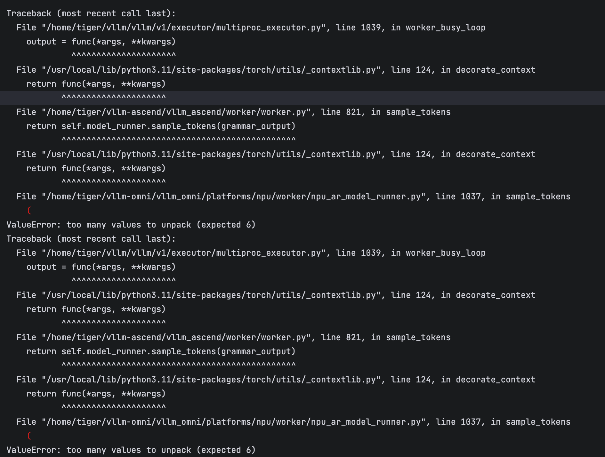

The vLLM-Ascend implementation returned two additional values, `_num_nans_in_logits` and `_num_nans_device`, for NaN detection:

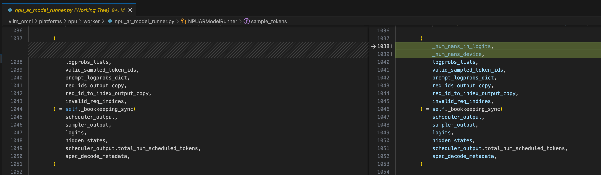

The experiment patched the vLLM-Omni NPU model runner to unpack eight values and ignore the two additional values where they were not consumed. When reproducing this issue, first verify the pinned vLLM-Omni and vLLM-Ascend revisions: a local compatibility patch should not be carried forward after the upstream interfaces have converged.

### 2.2 Reduce FSDP Gradient-Accumulation Memory

During the actor-update phase, several NPUs reached the 64 GiB device limit:

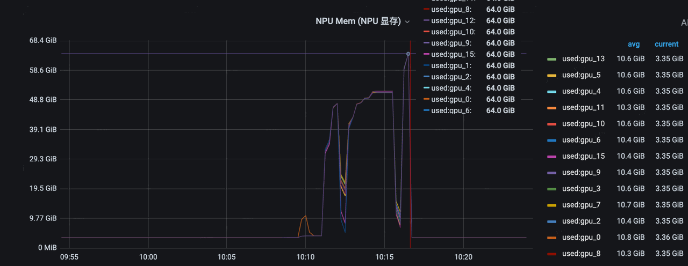

The memory snapshot showed a pronounced increase during backward:

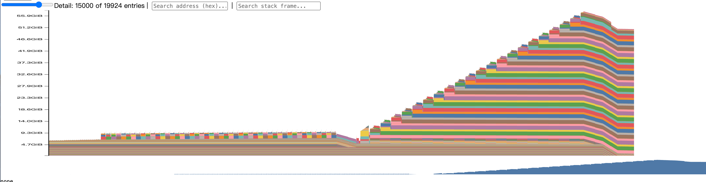

The experiment traced the increase to delayed gradient synchronization during accumulation. With `use_no_sync_for_gradient_accumulation=true`, non-final micro-batches skip reduce-scatter, reducing communication but requiring each rank to retain a full unsharded gradient until the final micro-batch.

Using the following notation:

- `P`: parameter count;
- `N`: FSDP world size;
- `M`: micro-batches per mini-batch;
- `b`: bytes per gradient element;

the synchronization-volume trade-off is approximately:

| Item | Synchronize every micro-batch | Delay synchronization |
| --- | --- | --- |
| Reduce-scatter operations per mini-batch | `M` | `1` |
| Total gradient synchronization volume | `M · b · P · (N−1) / N` | `b · P · (N−1) / N` |
| Per-rank gradient residency | Sharded after each backward | Full gradient retained during accumulation |

The experiment cherry-picked [verl PR #7458](https://github.com/verl-project/verl/pull/7458) and explicitly set:

```bash
actor_rollout_ref.actor.fsdp_config.use_no_sync_for_gradient_accumulation=false
```

This restored synchronization and resharding after each micro-batch backward. Peak memory dropped to approximately 36 GiB per NPU in the observed run, at the cost of additional communication.

### 2.3 Identify the KV-Cache Wake-Up Race

Async execution also exposed a lifecycle race in which request admission resumed after model weights were awake but before the KV cache had been restored:

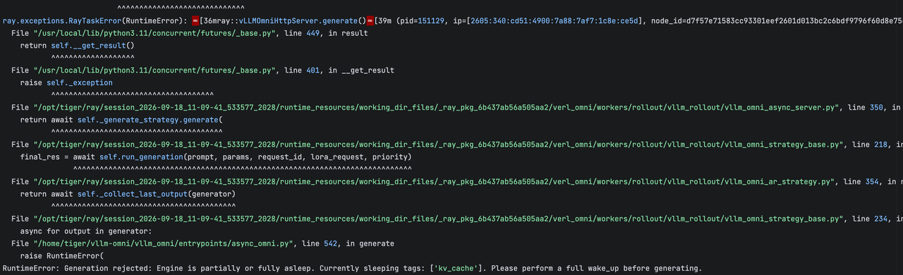

Requests entering this interval failed with `RuntimeError: KV Cache not available`. The diagnostic signature is a request arriving between weight wake-up and KV-cache wake-up. A robust fix must hold request admission until both resources are ready; the screenshot alone is diagnostic evidence, not proof that a particular upstream version contains the fix.

## 3. NPU Operator Patch

The training path was patched to use native `torch_npu` operators for Qwen-family modules, including `npu_rms_norm`, `npu_swiglu`, `npu_rotary_mul`, and `npu_grouped_matmul`. See [verl PR #7960](https://github.com/verl-project/verl/pull/7960) for the corresponding NPU patch framework.

In the observed 16-NPU run, the patched and unpatched reward curves followed similar trajectories:

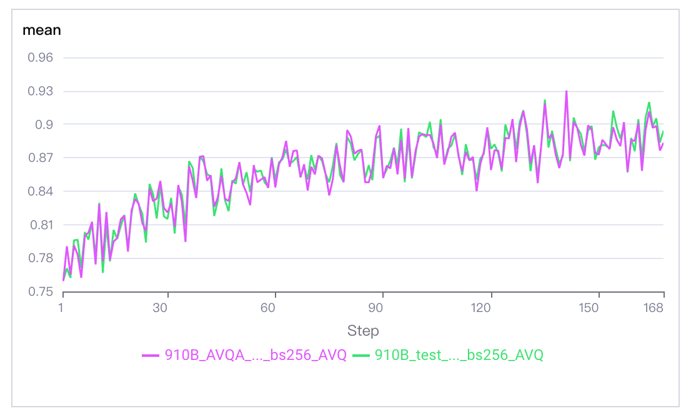

The actor-update measurement decreased by more than 20% in the captured comparison:

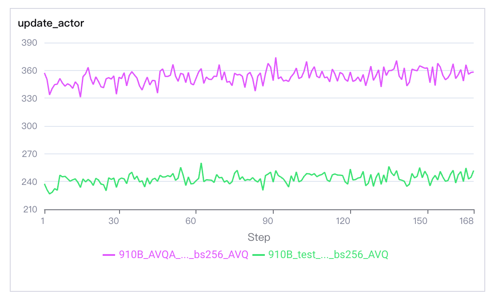

These plots represent one workload and revision set. Validate numerical parity and performance again when changing the model, CANN, `torch_npu`, or verl revision.

## 4. Separate-Async Tuning with RL Insight

In this section, `rXtY` denotes `X` rollout NPUs and `Y` training NPUs. Separate async uses disjoint resource pools, so configurations with different `X` and `Y` values do not use the same total number of NPUs. Compare both end-to-end throughput and throughput per allocated NPU.

### 4.1 Baseline: `r8t8`

| Parameter | Value |
| --- | --- |
| Train batch size | 256 |
| PPO mini-batch size | 32 |
| Parameter sync step | 8 |
| Warm-up batches | 1 |
| PPO maximum tokens per NPU | 10k |

Before the first replay-buffer sample was ready, the hybrid engine could participate in rollout. In steady state, however, inference was substantially faster than training. Rollouters ran approximately five PPO mini-batches ahead and then waited:


The response-length distribution was long-tailed, which amplified completion-time imbalance across replicas.

### 4.2 Add Training Capacity: `r8t16`

Increasing the training pool and setting two warm-up batches reduced the gap from approximately five to three PPO mini-batches:


NPU memory monitoring still showed training-side headroom:

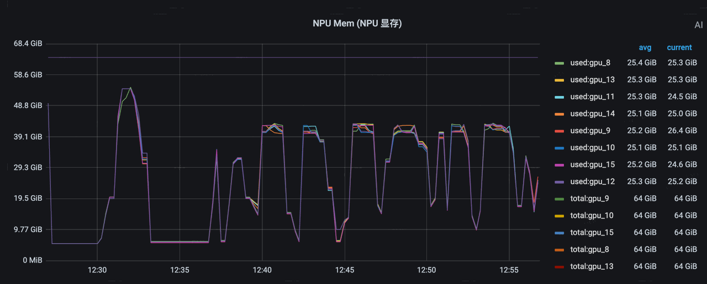

Increasing the PPO maximum token budget from 10k to 30k converted that headroom into more training work per iteration. The rollout bubble decreased further, to approximately 1.5 mini-batches:


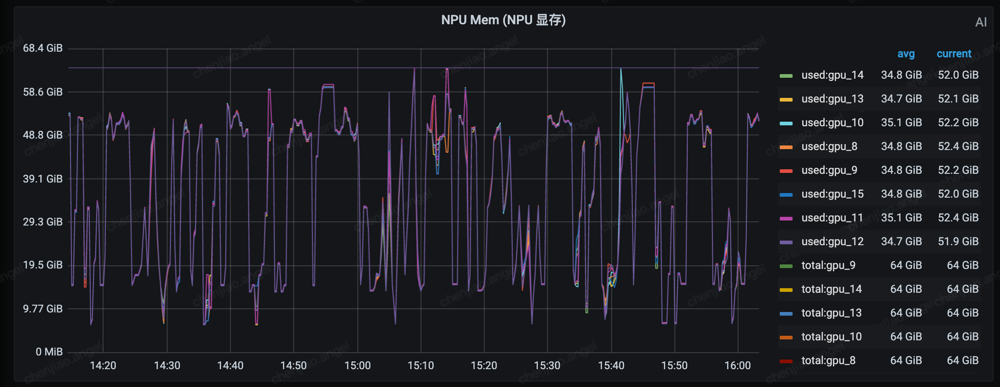

The captured throughput comparison includes the `r8t8`, `r8t16`, and synchronous configurations:

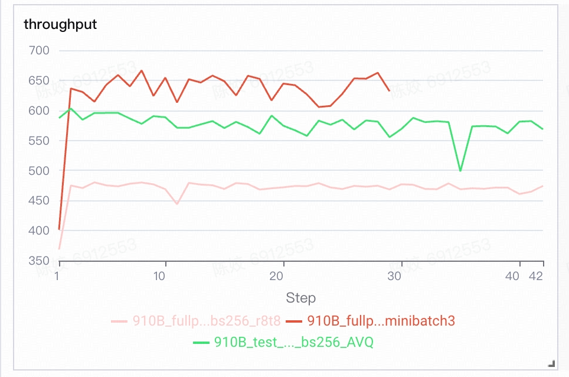

The tuning sequence was:

1. Use the RL Insight timeline to identify that rollout was consistently ahead of training.
2. Rebalance the Trainer/Rollouter resource ratio.
3. Confirm training-side memory headroom.
4. Increase the PPO token budget until the speed gap narrowed while retaining a memory safety margin.

## 5. Experimental Colocate-Async Tuning

Colocate async uses the same NPU pool for training and rollout. The two phases alternate, avoiding a static Trainer/Rollouter split but making wake-up, abort, and request-drain behavior critical.

### 5.1 Two Warm-Up Batches and a 10k Token Budget

With `warm_up_batch=2` and a 10k PPO token budget, the high-level timeline showed regular alternation between rollout and actor update:

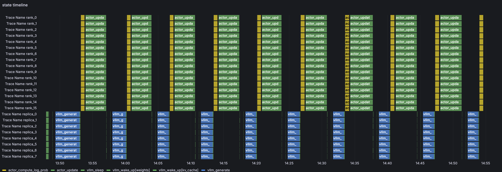

Cache-utilization and scheduler-state views showed that some ranks still reached `running_request=0` while other ranks remained active:

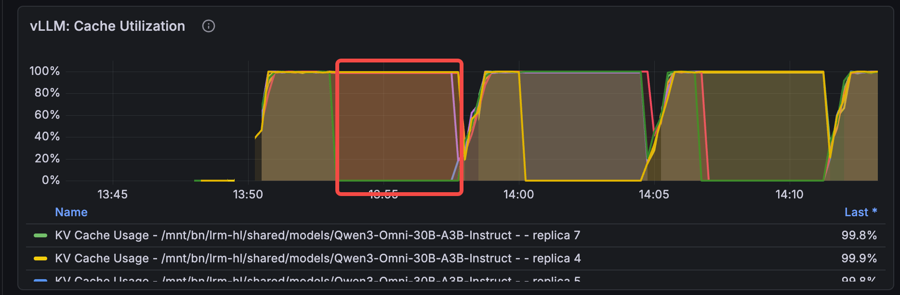

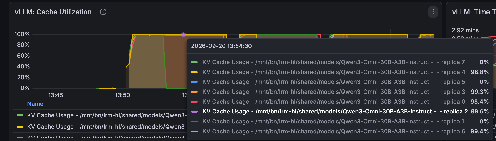

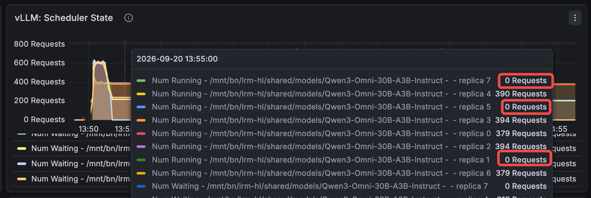

The detailed timeline suggests that shorter requests finished first while longer requests remained active or were aborted at the actor-update boundary:

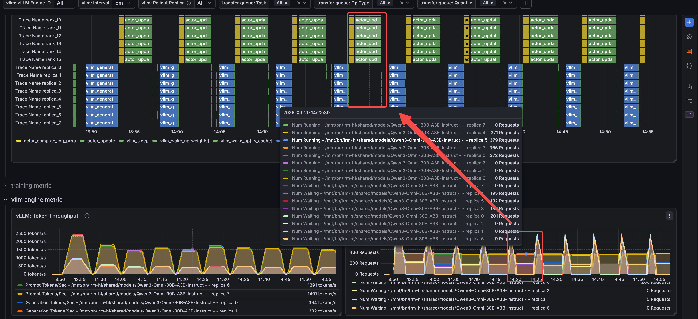

When this pattern appears, inspect the response-length distribution, per-rank request counts, and abort events together. Average cache utilization alone can hide ranks that have already drained.

### 5.2 One Warm-Up Batch and a 30k Token Budget

The second experiment used `warm_up_batch=1` and raised the PPO token budget to 30k:

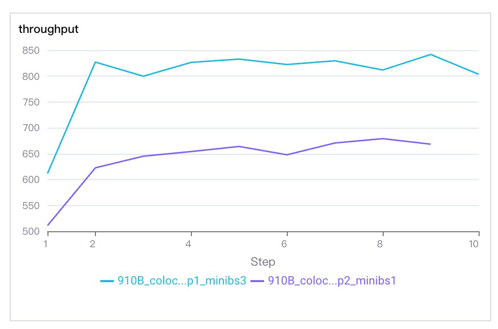

The headline same-device comparison used in this case increased throughput from 593 to 746 tokens/s, approximately 25.8%, relative to the synchronous baseline. Other dashboard captures contain step-local values around 650–830 and 590–830; those values come from different captured windows and must not be treated as the same benchmark statistic.

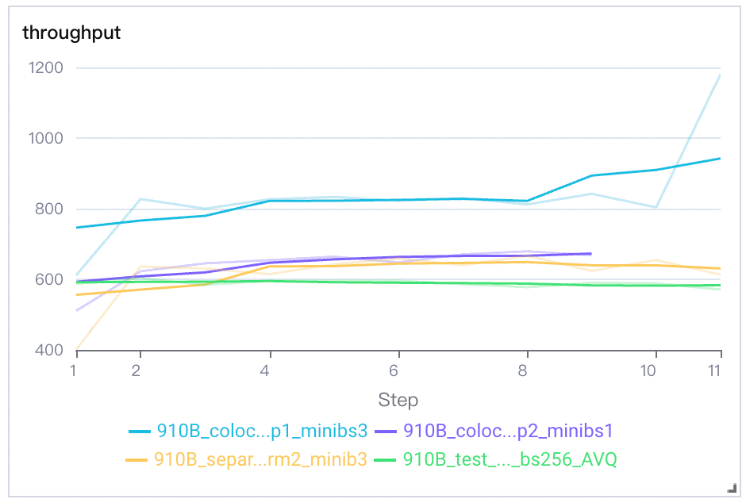

The single-run accuracy and reward curves are shown below:

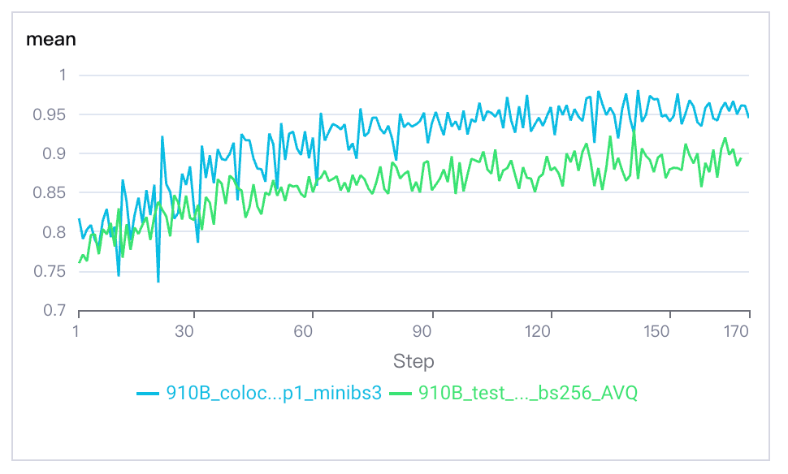

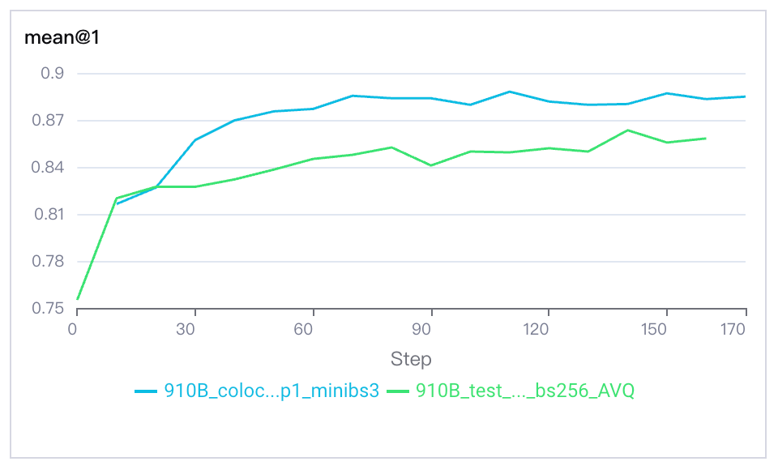

The colocate run was higher in these captures, but this is an observation rather than evidence that async execution improves model quality. Establishing a quality difference requires controlled multi-seed runs with identical data order, validation settings, optimizer hyperparameters, and stopping criteria.

## 6. Reproduction and Reporting Checklist

Before comparing execution modes, keep the following items explicit:

- exact repository commits and local patches;
- total NPU count and, for separate async, the Trainer/Rollouter split;
- model components that are trained, frozen, or excluded;
- train batch, PPO mini-batch, rollout count, TP, SP, and parameter-sync interval;
- prompt, response, and PPO token limits;
- warm-up interval and the steady-state steps used for measurement;
- whether validation and checkpoint time are included;
- the precise throughput definition: generated tokens, trained tokens, or end-to-end tokens per second;
- peak allocated and reserved HBM per rank;
- reward and accuracy across multiple seeds when making quality claims.

For this workload, the most useful RL Insight signals were:

| Question | RL Insight evidence |
| --- | --- |
| Which side owns the bubble? | Trainer/Rollouter state timeline |
| Are all rollout ranks busy? | `running_request`, scheduler state, and cache utilization per rank |
| Can training absorb more work? | Per-rank HBM timeline during actor update |
| Are long responses creating tails? | Response-length distribution and request completion timeline |
| Does throughput tuning affect quality? | Reward, accuracy, and staleness curves evaluated together |

## 7. Key Takeaways

1. **Resolve cross-repository compatibility before tuning.** API mismatches and lifecycle races can look like model or scheduling failures.
2. **Treat delayed FSDP synchronization as a memory/communication trade-off.** On this 30B MoE workload, retaining full gradients caused OOM, while per-micro-batch synchronization reduced peak HBM to approximately 36 GiB.
3. **Use timelines to identify the slower side.** In separate async, Rollouters ran ahead of the Trainer; adding training capacity and increasing the PPO token budget reduced bubbles.
4. **Inspect rank-level rollout state.** Colocate averages can hide ranks with no running requests while long-tail requests remain elsewhere.
5. **Report one authoritative throughput statistic.** Dashboard screenshots from different windows are useful diagnostic evidence but are not interchangeable benchmark results.
6. **Do not infer quality improvements from a single async run.** Throughput and training quality require separate, controlled validation.
